🇬🇧 [Read in English](#-english) | 🇮🇹 [Leggi in Italiano](#-italiano)

---

# 🇬🇧 English

# Dice Soccer — Fan Remaster (2012 iOS Classic)

<p align="center">
  
</p>

<p align="center">
  <a href="https://github.com/KaraZero0/DiceSoccerLeague/releases/latest"></a>
  
  
  
  
  
</p>

---

## 📖 Overview

**Dice Soccer** is an authentic, 1:1 fan remaster and historical preservation of the cult-classic 2011/2012 iOS title originally developed by **LambdaMu Games**. 

When Apple deprecated 32-bit application support in iOS 11, the original game vanished into abandonware. This project restores every single aspect of the classic experience — extracting 100% of the original Cocos2d sprite sheets, original audio effects, Krungthep typography, and character rosters — re-engineered from the ground up in **Unity 6 (6000.6 LTS)** as a native 64-bit Android application.

> [!IMPORTANT]
> **100% Non-Profit Fan Remaster**: All 96 historical players, jerseys, tournament cups, and coin packages are unlocked completely free. Zero ads, zero tracking, zero paywalls.

---

## 👑 Special Dedication: The Archive Legends

> [!NOTE]
> This remaster was born out of historical passion and dedication to mobile game preservation:
>
> * **Karazero**: Project Creator, Engineering & 1:1 Preservation
> * **jairsldn**: The Legendary Archive Guardian
>
> Across the entire internet, **jairsldn** was the only person who preserved and held the original 2012 iOS binaries and files of Dice Soccer. Without his archival passion and Karazero's dedication, this game would have been lost to history. Dice Soccer lives on for all fans! 🏆

---

## 🗂️ Project Architecture

| Component | Description |
|:---|:---|
| **[`unity`](https://github.com/KaraZero0/DiceSoccerLeague/tree/unity)** | **Main Unity 6 Branch**: Complete C# simulation engine (`Assets/Scripts/`), catalog & extracted assets, adaptive icons, verification test suite, and automated mobile CI/CD. |
| **[`Tools/`](https://github.com/KaraZero0/DiceSoccerLeague/tree/unity/Tools)** | **Reverse Engineering & Asset Pipeline**: Custom Python scripts (`cgbi.py`, `extract_assets.py`) to unpack Apple CgBI PNGs, Cocos2d `.plist` atlases, and ARMv7 catalog data from an offline `.ipa` archive. |
| **[`.github/workflows/`](https://github.com/KaraZero0/DiceSoccerLeague/tree/unity/.github/workflows)** | **Automated Builds**: macOS `xcodebuild` pipeline compiling and packaging signed `.ipa` alongside the Android `.apk` into GitHub Releases. |

---

## 🎮 Key Features & Remaster Highlights

* **1:1 Authentic Match Simulation**:
  * 5 discrete tactical field zones (`-2` to `+2`) with authentic ball possession transfer.
  * Faithful 1-3-3 team formation (Goalkeeper on net, 3 outfielders per duel).
  * 3v3 outfield dice rolls with authentic player dice faces (numeric values, `0`, `15+` buffs, Wild `31`, Whistle `32`).
  * Intense 1v1 Central Forward vs Goalkeeper penalty duels when reaching the net zone.
  * 15-minute decrementing game clock with stoppage time.
* **All 96 Historical Players & 21 Entourage Staff**:
  * Earn every character across all 5 original seasons & cups (*Training Season, Bootcamp, Turf War, High Rollers, Just for Kicks*) and all 72 achievements with zero paywalls.
  * All 67 original abilities across phases 0–5: *Dribble, Cross, Tackle, Steal, Step-Over, Anchor, Intercept, Charge, Feint, Through Pass, Dive!, Critical Striker, Bicycle Kick, Captain*.
* **100% Original Graphics & Audio**:
  * Original pixel-art character spritesheets (`PlayerFigureSS`, `Prompt1`, `ShopSS`).
  * Authentic stadium audio, crowd chants (`CrowdMix`), referee whistles, and chiptune theme music.
  * Original typography (`Krungthep.ttf`) preserved pixel-for-pixel.
* **✨ Brand-New Feature — Local 1v1 "Pass & Play" Multiplayer**:
  * Challenge a friend directly on the same device!
  * Take turns rolling dice, managing bench tactics, and battling for supremacy.
* **Modern Android & Aspect Ratio Control**:
  * Native 64-bit ARM64 IL2CPP architecture (Package: `com.karazero.dicesoccer`).
  * **Aspect Ratio Options**: Toggle between the strict authentic 2:3 iOS aspect ratio (letterboxed/pillarboxed) or Edge-to-Edge Fullscreen on modern 18:9 / 19.5:9 / 20:9 screens directly in Options!
  * **Android Adaptive Icons**: Hand-crafted 512×512 full-bleed pitch background + high-res official crest foreground, perfectly framed on Google Pixel (circle) and Samsung (squircle).
* **Sharper UI & High-DPI Rendering**:
  * Crisp font and UI rasterization (`dynamicPixelsPerUnit = 2.5f`) for sharp presentation on modern 1080p, 1440p, and 4K mobile displays.

---

## 📸 Screenshots Gallery

### Match Action & Celebrations
<p align="center">
  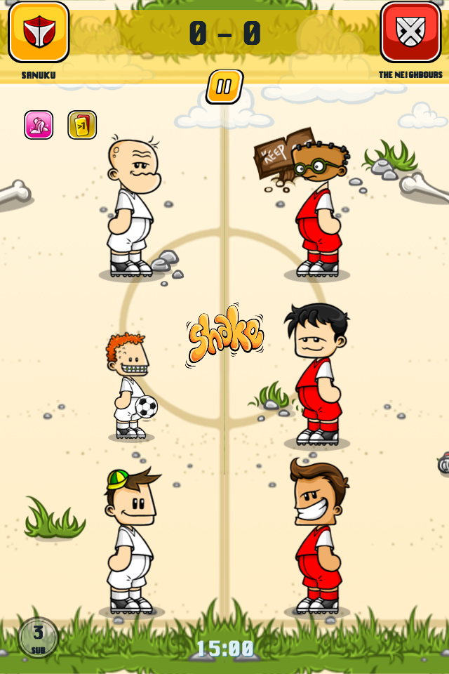
  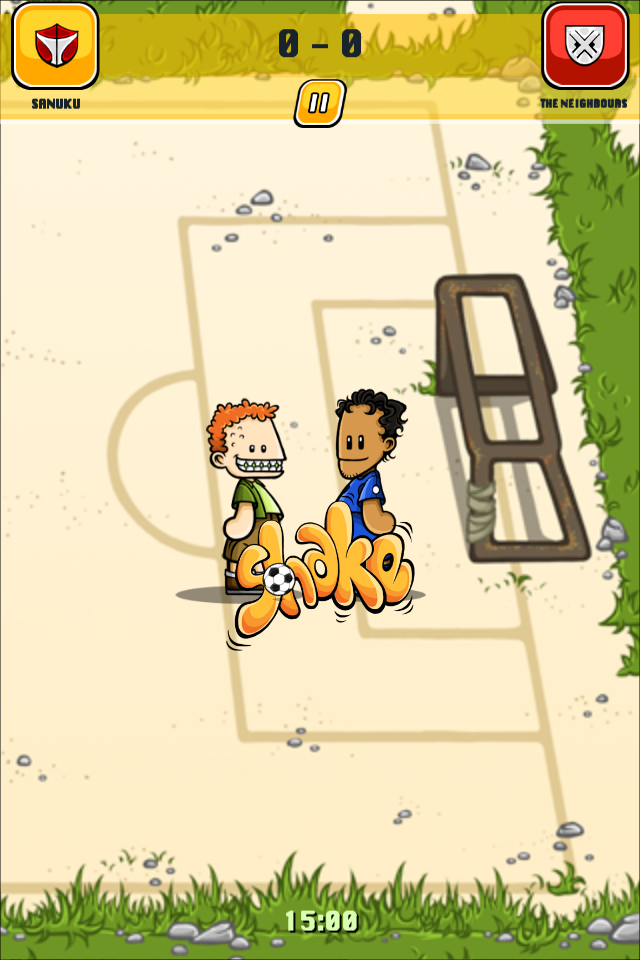
  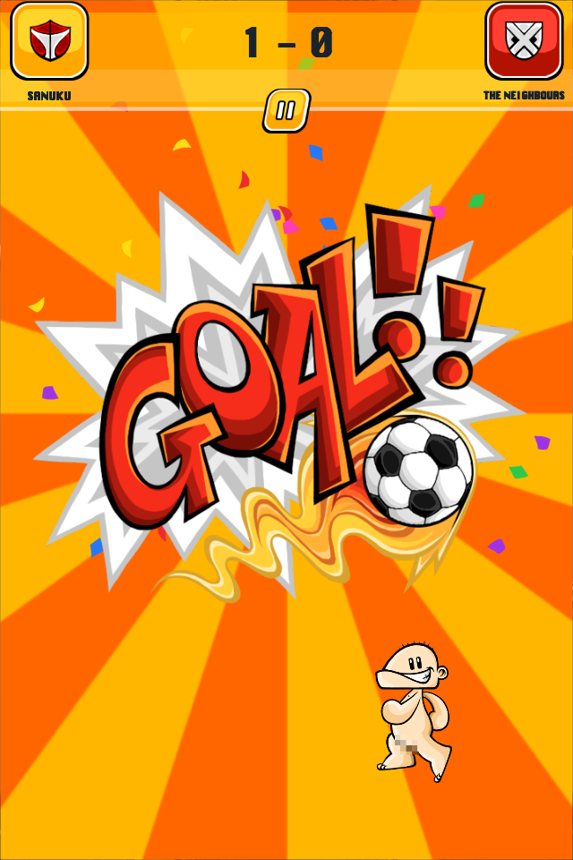
</p>

### Competitions & Fullscreen View
<p align="center">
  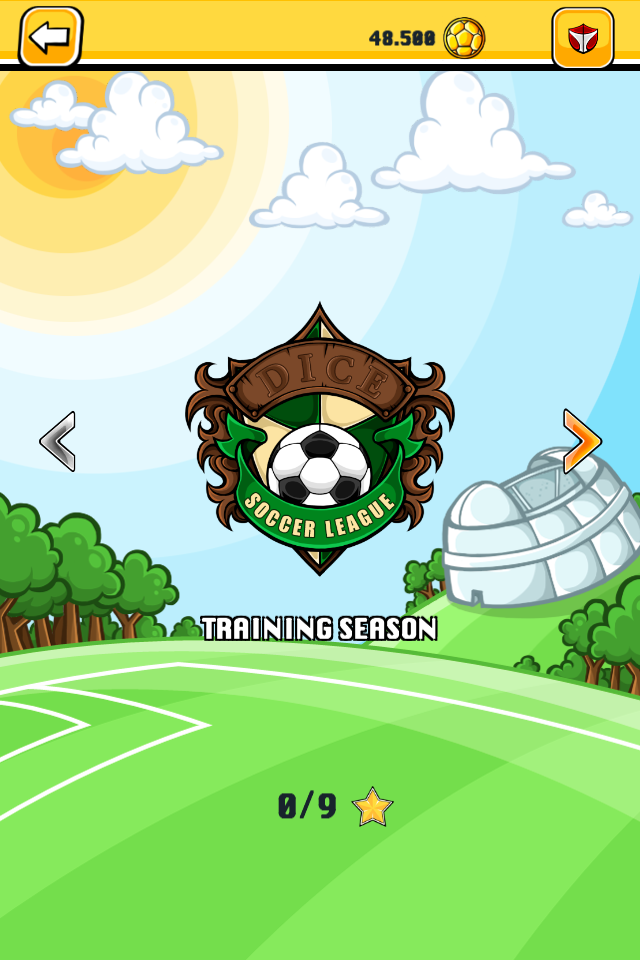
  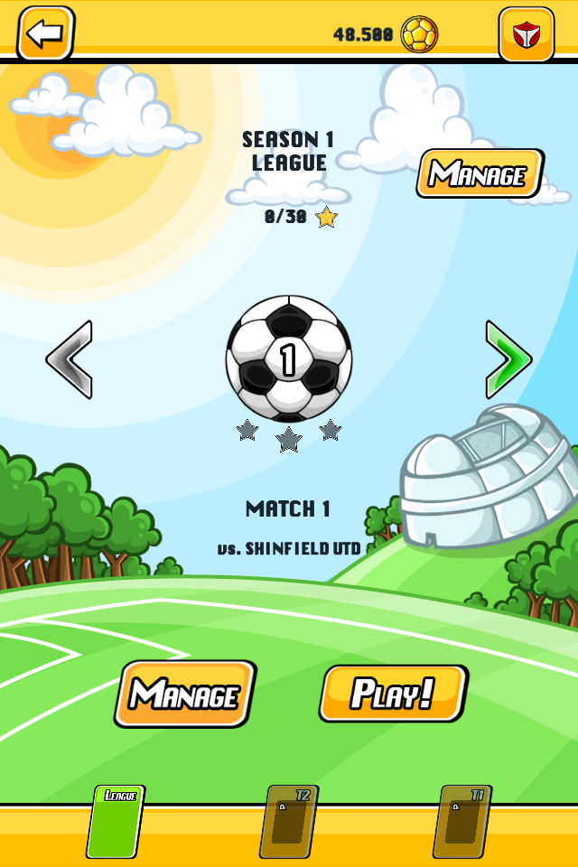
  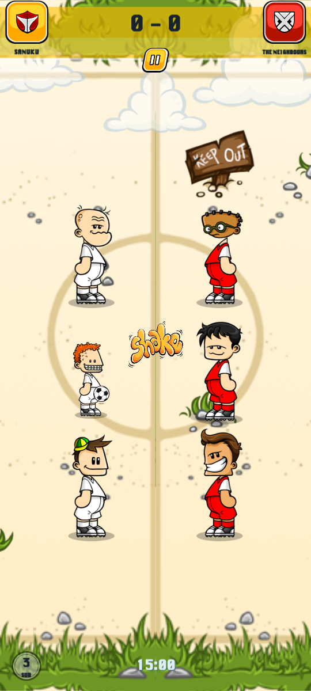
</p>

### Team Management & Customization
<p align="center">
  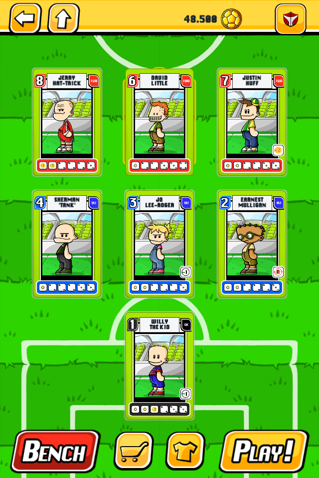
  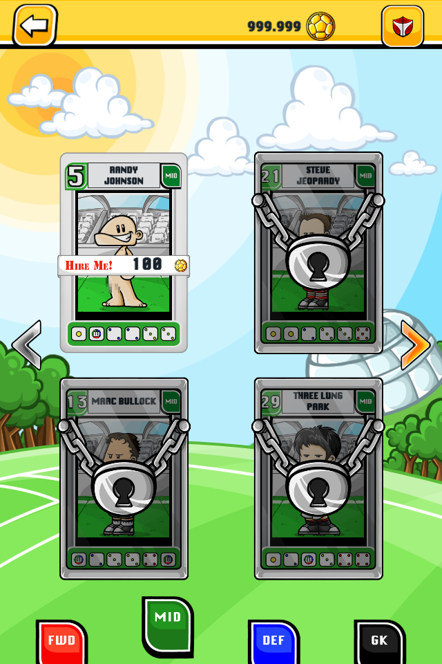
  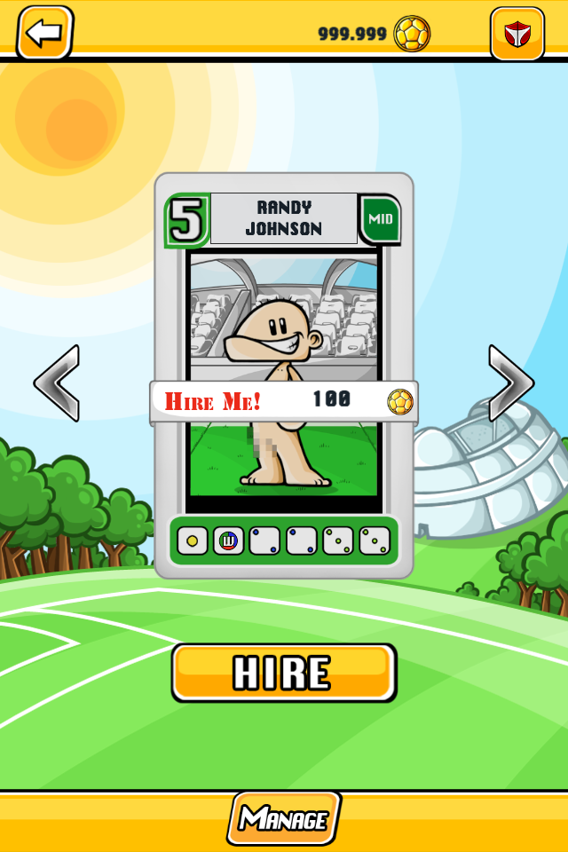
</p>

### Shop, Options & Dedication
<p align="center">
  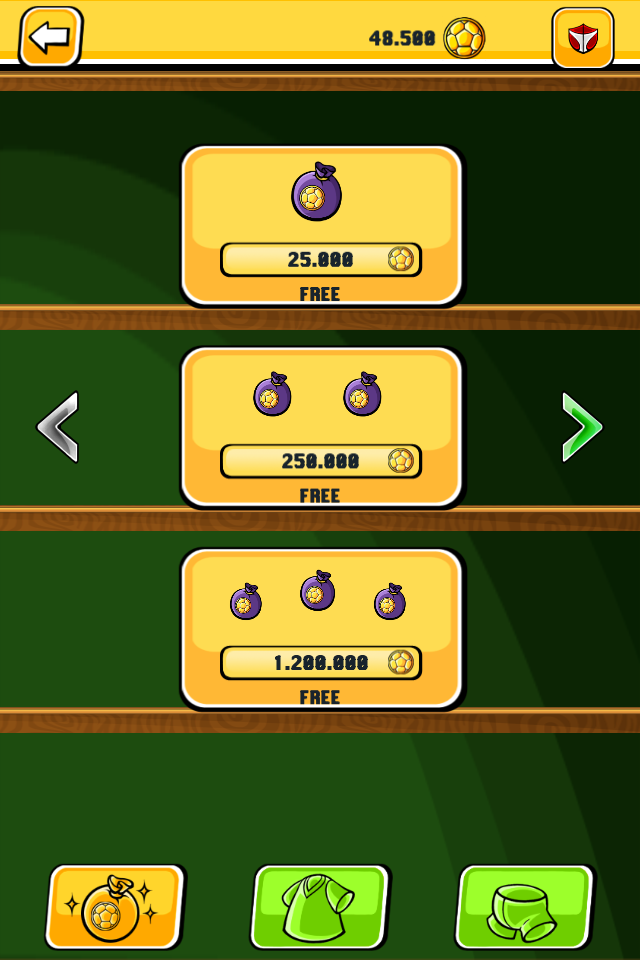
  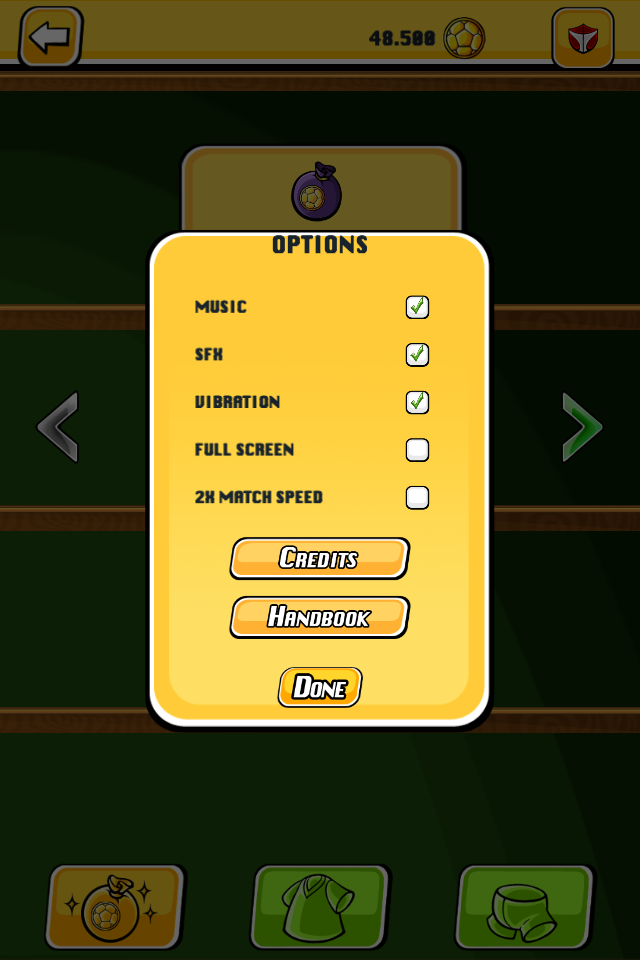
  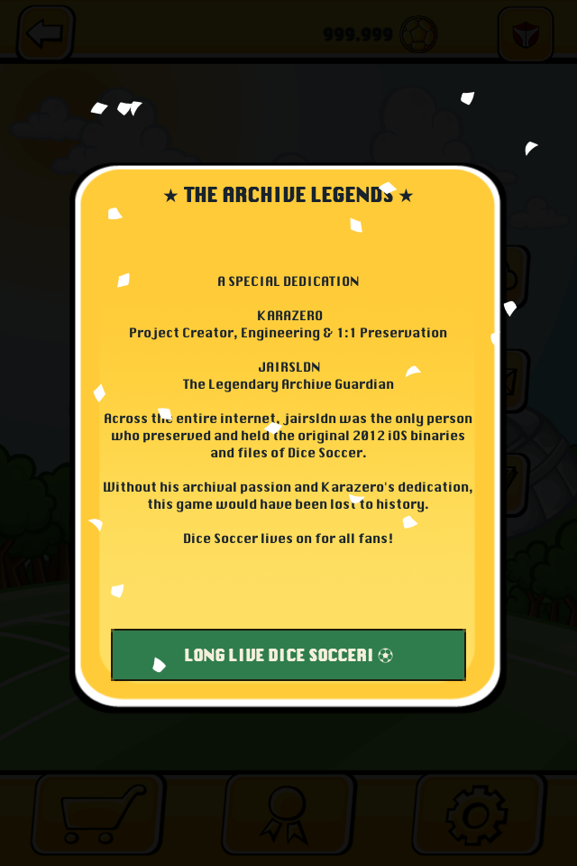
</p>

---

## 🔬 Gameplay Polish & Audio Audit Changelog

Following a thorough side-by-side analysis of the original 2012 iOS title and comparison footage:

1. **Ability Trigger Evaluation Fix**:
   - Superpower triggers for dice values (`trigger 19..28`) now check across the entire active duel lineup (`Array.IndexOf(faces, val) >= 0`), matching the authentic original design where abilities trigger when *the team* rolls the required value.
2. **Snapshot-Based Ability Evaluation**:
   - Duel abilities are evaluated against the initial rolled faces (`originalHomeFaces`, `originalAwayFaces`) and totals, eliminating phantom trigger loops when tackles modify dice in-place.
3. **Multiplier Superpowers & Reductions Fix**:
   - Multiplier abilities (*Critical Striker x2/x4*, *Bicycle Kick x3*) are explicitly tracked by ability ID.
   - *Shielding* (ID 48) is properly recognized as a reduction cleanser rather than inadvertently running as a multiplier.
4. **Snappy Arcade Animations**:
   - Goal celebration sequence streamlined to 1.6s with dynamic sunburst, confetti, and streaker.
   - Kickoff banner transition tightened to 0.75s for fast-paced arcade responsiveness.
5. **Interactive Target Selection**:
   - Target selection window expanded to 5.0 seconds with responsive tap audio, die punch scaling, and side verification.
6. **All Content 100% Free**:
   - All custom jerseys, shorts, boots, and coins are freely accessible with zero microtransactions.
7. **Pixel & Modern Cutout Edge-to-Edge Fullscreen**:
   - Enabled `renderOutsideSafeArea = true` and dynamic vertical pitch rendering to expand pitch grass and stadium scenery edge-to-edge on modern tall devices (16:10, 19.5:9, 20:9).
   - Added canvas-level continuous screen clearing and `RectMask2D` containment to eliminate stuck animation buffers / notch looping.
8. **Authentic Player Cards & Dice Sets**:
   - Restored authentic 2:3 card aspect ratio across `Manage`, `PlayerPicker`, and `Hiring`.
   - Redesigned card bottom dice bar with crisp square die tiles, legible pips, and position-colored framing.
9. **Enlarged Authentic Shop Display**:
   - Scaled `ShopBox` from 148×96 up to native 300×180, properly resting on wooden shelves with large money pouches, kit previews, and price badges.

---

## 📥 How to Install and Play

### 🤖 Android (APK)
1. Head to the **[Latest Release](https://github.com/KaraZero0/DiceSoccerLeague/releases/latest)** section.
2. Download **`DiceSoccer.apk`** (~60 MB).
3. Open the downloaded file on your Android device and tap **Install** (allow installation from unknown sources if prompted).
4. Launch **Dice Soccer** and enjoy!

*Via ADB (Command Line):*
```bash
adb install -r Builds/Android/DiceSoccer.apk
```

---

### 🍏 iOS (iPhone & iPad via Sideloading)
You do **NOT** need an Apple Developer Account, a Mac, or the App Store. Any personal, free Apple ID can sideload the game in minutes!

#### Method 1: Sideloadly (Recommended — Windows / Mac)
1. Download **`DiceSoccer.ipa`** from the **[Latest Release](https://github.com/KaraZero0/DiceSoccerLeague/releases/latest)** or GitHub Actions artifacts.
2. Download and install [Sideloadly](https://sideloadly.io/) (Free for Windows & macOS).
3. Connect your iPhone to your PC via USB cable (tap *"Trust this computer"* if prompted).
4. Drag and drop **`DiceSoccer.ipa`** into Sideloadly.
5. Enter your normal free Apple ID email and click **Start**.
6. On your iPhone, go to **Settings ➔ General ➔ VPN & Device Management**, tap your Apple ID, and select **Trust**.
7. Launch **Dice Soccer** and score some goals!

#### Method 2: SideStore / AltStore (Wireless Sideloading)
* Use [SideStore](https://sidestore.io/) or [AltStore](https://altstore.io/) to install the `.ipa` and refresh it automatically over Wi-Fi without needing a PC cable after setup.

#### Method 3: TrollStore (Permanent / No Expiration)
* If your device runs iOS 14.0–17.0 (supported by TrollStore), simply open `DiceSoccer.ipa` in TrollStore for permanent, signature-free installation.

---

## 🛠️ Building from Source

### Prerequisites
* **Unity 6 (`6000.6 LTS` or newer)** (Tested on `6000.6.6f1`).
* Unity Android Build Support module (OpenJDK, NDK r23b+, Android SDK platform tools).

### Build Steps
1. Clone the repository on the `unity` branch:
   ```bash
   git clone https://github.com/KaraZero0/DiceSoccerLeague.git -b unity
   cd DiceSoccerLeague
   ```
2. Open the project folder in **Unity Hub**.
3. Open the main startup scene: `Assets/Scenes/Main.unity`
4. To build the Android APK from command line (optionally pass release signing via environment variables `DICE_SOCCER_KEYSTORE`, `DICE_SOCCER_KEYSTORE_PASS`, `DICE_SOCCER_KEY_ALIAS`, `DICE_SOCCER_KEY_PASS`; if unset, builds unsigned/debug):
   ```bash
   Unity -quit -batchmode -projectPath . -executeMethod DiceSoccer.Editor.ConfigureMobileBuild.BuildAndroid -logFile build_android.log
   ```
   The compiled APK will be created at `Builds/Android/DiceSoccer.apk`.

---

## ☕ Support the Project

This is an independent non-profit fan project made out of pure love for preserving classic mobile gaming history. 

If you are enjoying the remaster and would like to buy a coffee to support the developer:
👉 **[paypal.me/Freekara3](https://paypal.me/Freekara3)**

---

## ⚖️ Legal & Preservation Disclaimer

This is a non-profit fan-made remaster developed solely for educational, archival, and historical game preservation purposes under Fair Use principles.

* All original visual assets, character designs, game concepts, and audio tracks remain the intellectual property of their original creators and rights holders (**LambdaMu Games**).
* This project is completely free of charge, contains no advertisements, no in-app purchases, and does not generate revenue.
* If you are a copyright holder and have concerns, please contact the repository owner.


<br><br>

---

# 🇮🇹 Italiano

# Dice Soccer — Fan Remaster (Classico iOS 2012)

<p align="center">
  
</p>

## 📖 Panoramica

**Dice Soccer** è un remaster 1:1 fedele e un progetto di conservazione storica del titolo cult iOS del 2011/2012 sviluppato originariamente da **LambdaMu Games**.

Quando Apple ha rimosso il supporto alle app a 32 bit in iOS 11, il gioco originale è scomparso diventando abandonware. Questo progetto ne ripristina ogni singolo aspetto — estraendo al 100% gli sprite sheet Cocos2d originali, gli effetti audio, il font Krungthep e i roster dei personaggi — ricostruito da zero in **Unity 6 (6000.6 LTS)** come applicazione nativa a 64 bit per Android e iOS.

> [!IMPORTANT]
> **Fan Remaster 100% No-Profit**: Tutti i 96 giocatori storici, le divise, i tornei e i pacchetti di monete sono sbloccati gratuitamente. Zero pubblicità, zero tracciamento, zero paywall.

---

## 👑 Dedica Speciale: Le Leggende dell'Archivio

* **Karazero**: Creatore del progetto, Ingegnerizzazione & Conservazione 1:1
* **jairsldn**: Custode dell'Archivio Originale

In tutta la rete, **jairsldn** è stato l'unico ad aver conservato i binari e i file originali iOS del 2012 di Dice Soccer, permettendoci di riportarlo in vita. 🏆

---

## 🗂️ Struttura del Progetto

| Componente | Descrizione |
|:---|:---|
| **[`unity`](https://github.com/KaraZero0/DiceSoccerLeague/tree/unity)** | **Branch Principale Unity 6**: Il progetto Unity completo con motore di simulazione in C#, asset estratti, icone adattive, suite di test automatici e pipeline CI/CD mobile. |
| **[`Tools/`](https://github.com/KaraZero0/DiceSoccerLeague/tree/unity/Tools)** | **Reverse Engineering & Asset Pipeline**: Script Python custom (`cgbi.py`, `extract_assets.py`) per convertire PNG CgBI Apple, sprite sheet Cocos2d `.plist` e catalogo dati da un archivio `.ipa` offline. |
| **[`.github/workflows/`](https://github.com/KaraZero0/DiceSoccerLeague/tree/unity/.github/workflows)** | **Build Automatizzate**: Workflow macOS (`xcodebuild`) che compila e impacchetta `.ipa` insieme all'`.apk` Android nelle GitHub Releases. |

---

## 🎮 Funzionalità Principali

* **Simulazione Partita 1:1**: 5 zone tattiche di campo (`-2` a `+2`), formazione 1-3-3, tiri 3v3 con facce dei dadi autentiche (valori numerici, `0`, buff `15+`, Wild `31`, Whistle `32`), duelli 1v1 attaccante vs portiere e cronometro da 15 minuti con recupero.
* **Tutti i 96 Giocatori Storici & 21 Staff Entourage**: tutte le 5 stagioni e coppe originali (*Training Season, Bootcamp, Turf War, High Rollers, Just for Kicks*), 72 achievement e tutte le 67 abilità originali (*Dribble, Cross, Tackle, Steal, Step-Over, Anchor, Intercept, Charge, Feint, Through Pass, Dive!, Critical Striker, Bicycle Kick, Captain*).
* **Grafica e Audio Originali al 100%**: sprite sheet, cori, fischietti, musica chiptune e font `Krungthep.ttf` originali.
* **Multigiocatore Locale 1v1 "Pass & Play"**: sfida un amico sullo stesso dispositivo.
* **Supporto Schermi Moderni & Architettura 64-bit**: build nativa ARM64 IL2CPP (`com.karazero.dicesoccer`), opzione aspect ratio classico 2:3 o Fullscreen Edge-to-Edge (18:9 / 19.5:9 / 20:9), velocità `2X` dalle Opzioni e icone adattive Android.

---

## 📥 Installazione e Compilazione

* **Android (APK)** e **iOS (IPA tramite Sideloadly / AltStore / TrollStore)**: disponibili nella sezione **[Latest Release](https://github.com/KaraZero0/DiceSoccerLeague/releases/latest)**.
* **Build da sorgente**: richiede **Unity 6 (`6000.6 LTS` o superiore)** sul branch `unity` (`git clone https://github.com/KaraZero0/DiceSoccerLeague.git -b unity`). La firma release Android usa opzionalmente variabili d'ambiente (`DICE_SOCCER_KEYSTORE*`), mai committate nel repository.

---

## ⚖️ Disclaimer Legale

Progetto amatoriale no-profit sviluppato esclusivamente a scopo educativo, di archiviazione e preservazione storica del software. Tutti gli asset grafici, i personaggi e le tracce audio originali appartengono ai rispettivi detentori dei diritti (**LambdaMu Games**). Nessuna monetizzazione, pubblicità o acquisto in-app presente.
