# Dice Soccer — Android Fan Remaster (2012 iOS Classic)

<p align="center">
  
</p>

<p align="center">
  <a href="https://github.com/KaraZero0/DiceSoccerLeagueOriginal/releases/latest"></a>
  
  
  
  
  
</p>

---

## 📖 Overview

**Dice Soccer** is an authentic, 1:1 fan remaster and historical preservation of the cult-classic 2011/2012 iOS title originally developed by **LambdaMu Games**. 

When Apple deprecated 32-bit application support in iOS 11, the original game vanished into abandonware. This project restores every single aspect of the classic experience — extracting 100% of the original Cocos2d sprite sheets, original audio effects, Krungthep typography, and character rosters — re-engineered from the ground up in **Unity 6 (6000.6 LTS)** as a native 64-bit Android application.

> [!IMPORTANT]
> **100% Non-Profit Fan Remaster**: All 96 historical players, jerseys, tournament cups, and coin packages are unlocked completely free. Zero ads, zero tracking, zero paywalls.

---

## 👑 Special Dedication: The Archive Legends

> [!NOTE]
> This remaster was born out of historical passion and dedication to mobile game preservation:
>
> * **Karazero**: Project Creator, Engineering & 1:1 Preservation
> * **jairsldn**: The Legendary Archive Guardian
>
> Across the entire internet, **jairsldn** was the only person who preserved and held the original 2012 iOS binaries and files of Dice Soccer. Without his archival passion and Karazero's dedication, this game would have been lost to history. Dice Soccer lives on for all fans! 🏆

---

## 🗂️ Repository Branches Structure

This repository is organized into two primary branches:

| Branch | Description |
|:---|:---|
| **[`unity`](https://github.com/KaraZero0/DiceSoccerLeagueOriginal/tree/unity)** | **The Modern Remaster**: The complete, standalone Unity 6 project containing the full C# simulation engine, extracted assets, high-res adaptive icons, automated mobile build pipeline, and verification suites. |
| **[`original-ipa`](https://github.com/KaraZero0/DiceSoccerLeagueOriginal/tree/original-ipa)** | **Historical Archive**: The raw, decrypted 2012 iOS `.ipa` bundle (`Payload/Dice Soccer.app` and `iTunesArtwork`), preserved strictly for reverse engineering and digital archiving purposes. |

---

## 🎮 Key Features & Remaster Highlights

* **1:1 Authentic Match Simulation**:
  * 5 discrete tactical field zones (`-2` to `+2`) with authentic ball possession transfer.
  * Faithful 1-3-3 team formation (Goalkeeper on net, 3 outfielders per duel).
  * 3v3 outfield dice rolls with authentic player dice faces (values 1–32).
  * Intense 1v1 Central Forward vs Goalkeeper penalty duels when reaching the net zone.
  * 15-minute decrementing game clock with stoppage time.
* **All 96 Historical Players Unlocked**:
  * Every character from Novice, Amateur, Pro, Champion, and Legend leagues.
  * Real special abilities: *Tackle, Slide, Save, Header, Bicycle Kick, Charge, Dribble*.
* **100% Original Graphics & Audio**:
  * Original pixel-art character spritesheets (`PlayerFigureSS`, `Prompt1`, `ShopSS`).
  * Authentic stadium audio, crowd chants (`CrowdMix`), referee whistles, and chiptune theme music.
  * Original typography (`Krungthep.ttf`) preserved pixel-for-pixel.
* **✨ Brand-New Feature — Local 1v1 "Pass & Play" Multiplayer**:
  * Challenge a friend directly on the same device!
  * Take turns rolling dice, managing bench tactics, and battling for supremacy.
* **Modern Android & Aspect Ratio Control**:
  * Native 64-bit ARM64 IL2CPP architecture (Package: `com.karazero.dicesoccer`).
  * **Aspect Ratio Options**: Toggle between the strict authentic 2:3 iOS aspect ratio (letterboxed/pillarboxed) or Edge-to-Edge Fullscreen on modern 18:9 / 19.5:9 / 20:9 screens directly in Options!
  * **Android Adaptive Icons**: Hand-crafted 512×512 full-bleed pitch background + high-res official crest foreground, perfectly framed on Google Pixel (circle) and Samsung (squircle).
* **Sharper UI & High-DPI Rendering**:
  * Crisp font and UI rasterization (`dynamicPixelsPerUnit = 2.5f`) for sharp presentation on modern 1080p, 1440p, and 4K mobile displays.

---

## 📸 Screenshots Gallery

### Match Action & Celebrations
<p align="center">
  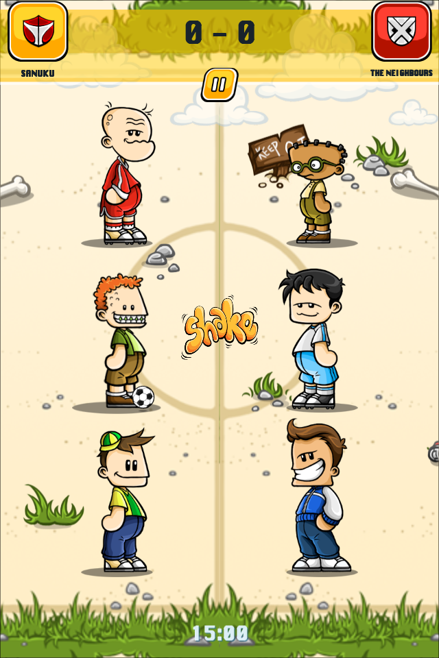
  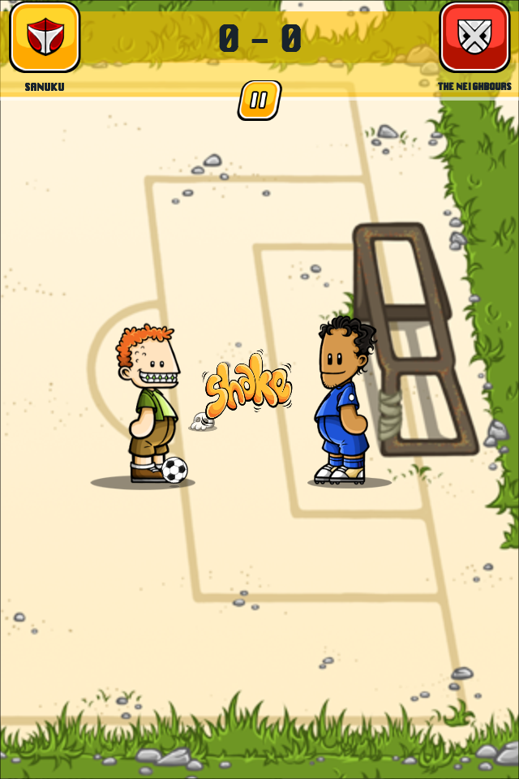
  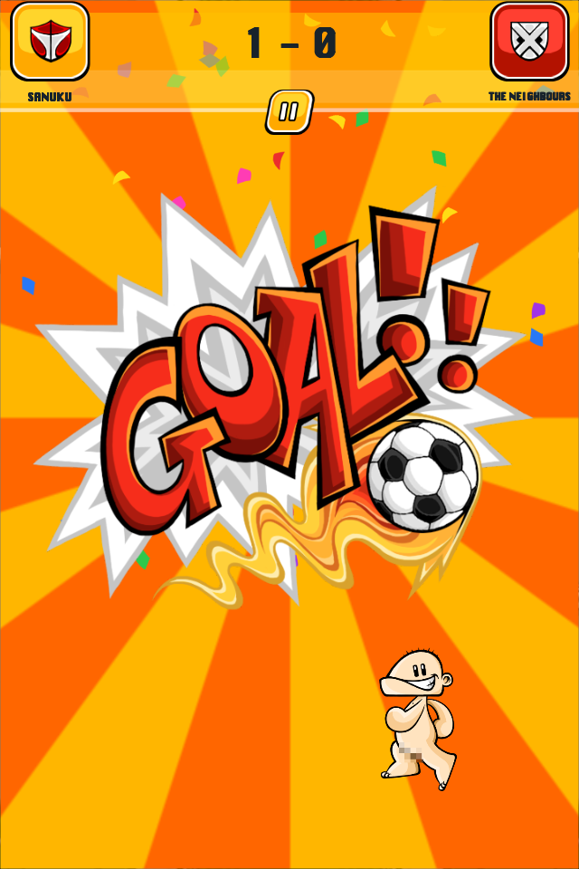
</p>

### Competitions & Fullscreen View
<p align="center">
  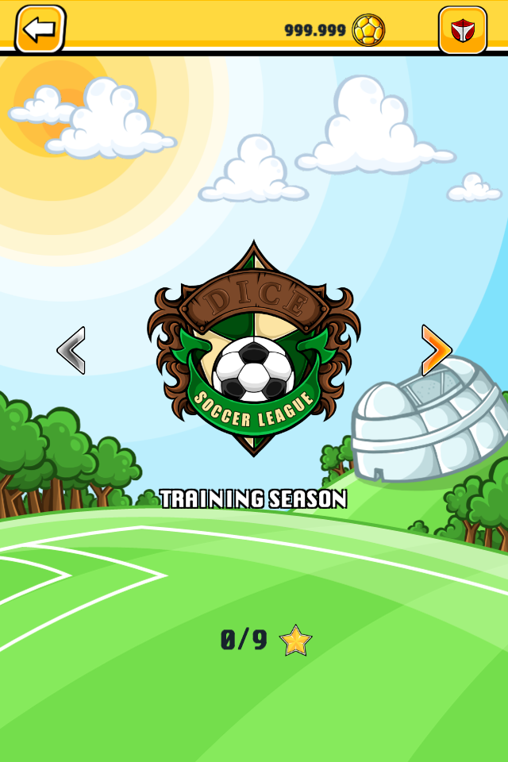
  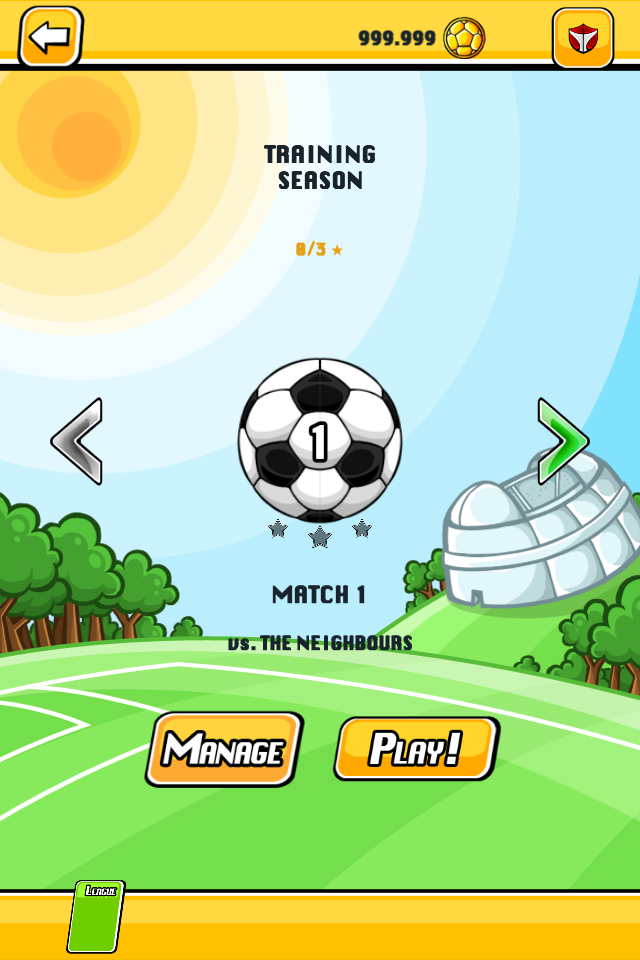
  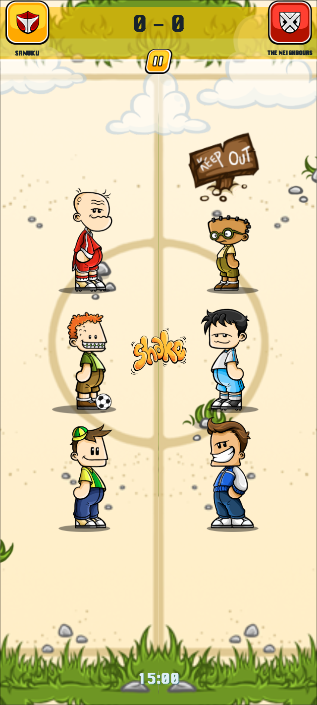
</p>

### Team Management & Customization
<p align="center">
  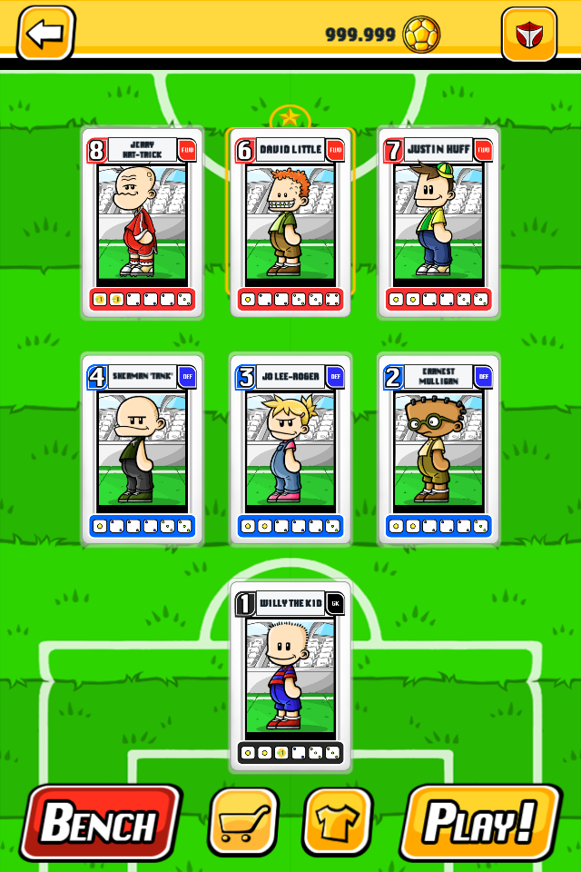
  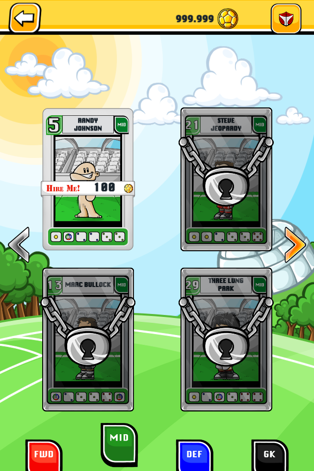
  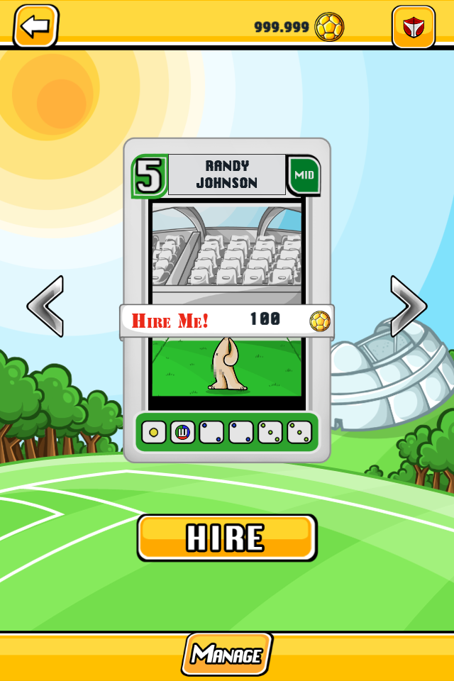
</p>

### Shop, Options & Dedication
<p align="center">
  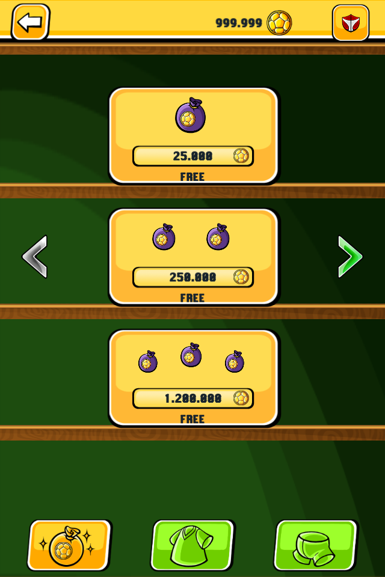
  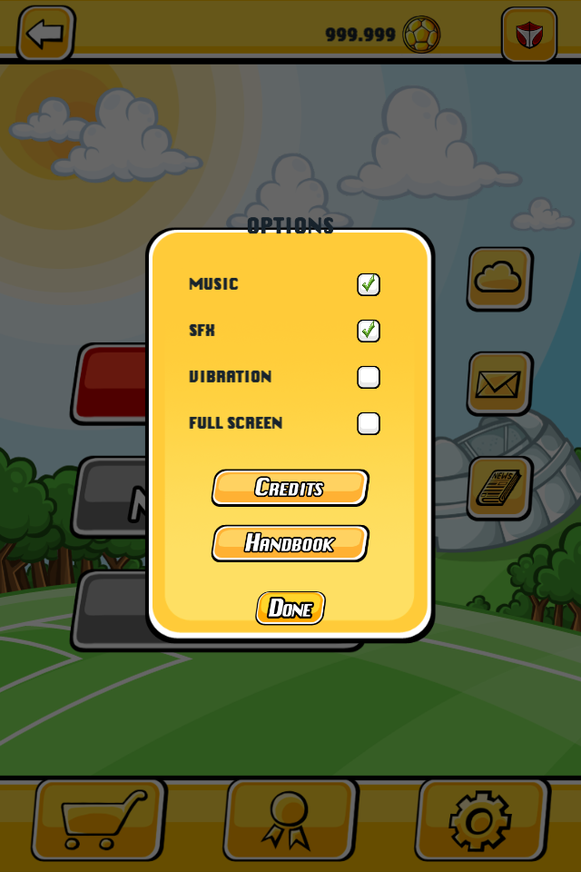
  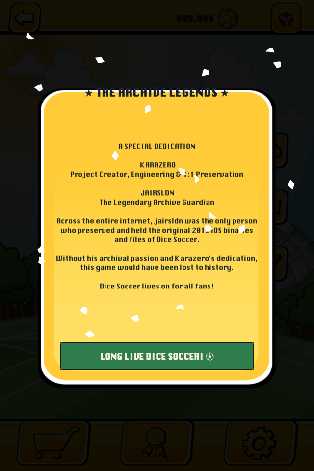
</p>

---

## 🔬 Gameplay Polish & Audio Audit Changelog

Following a thorough side-by-side analysis of the original 2012 iOS title and comparison footage:

1. **Ability Trigger Evaluation Fix**:
   - Superpower triggers for dice values (`trigger 19..28`) now check across the entire active duel lineup (`Array.IndexOf(faces, val) >= 0`), matching the authentic original design where abilities trigger when *the team* rolls the required value.
2. **Snapshot-Based Ability Evaluation**:
   - Duel abilities are evaluated against the initial rolled faces (`originalHomeFaces`, `originalAwayFaces`) and totals, eliminating phantom trigger loops when tackles modify dice in-place.
3. **Multiplier Superpowers & Reductions Fix**:
   - Multiplier abilities (*Critical Striker x2/x4*, *Bicycle Kick x3*) are explicitly tracked by ability ID.
   - *Shielding* (ID 48) is properly recognized as a reduction cleanser rather than inadvertently running as a multiplier.
4. **Snappy Arcade Animations**:
   - Goal celebration sequence streamlined to 1.6s with dynamic sunburst, confetti, and streaker.
   - Kickoff banner transition tightened to 0.75s for fast-paced arcade responsiveness.
5. **Interactive Target Selection**:
   - Target selection window expanded to 5.0 seconds with responsive tap audio, die punch scaling, and side verification.
6. **All Content 100% Free**:
   - All custom jerseys, shorts, boots, and coins are freely accessible with zero microtransactions.
7. **Pixel & Modern Cutout Edge-to-Edge Fullscreen**:
   - Enabled `renderOutsideSafeArea = true` and dynamic vertical pitch rendering to expand pitch grass and stadium scenery edge-to-edge on modern tall devices (16:10, 19.5:9, 20:9).
   - Added canvas-level continuous screen clearing and `RectMask2D` containment to eliminate stuck animation buffers / notch looping.
8. **Authentic Player Cards & Dice Sets**:
   - Restored authentic 2:3 card aspect ratio across `Manage`, `PlayerPicker`, and `Hiring`.
   - Redesigned card bottom dice bar with crisp square die tiles, legible pips, and position-colored framing.
9. **Enlarged Authentic Shop Display**:
   - Scaled `ShopBox` from 148×96 up to native 300×180, properly resting on wooden shelves with large money pouches, kit previews, and price badges.

---

## 📥 How to Install and Play (Android)

### Direct APK Download
1. Head to the **[Latest Release](https://github.com/KaraZero0/DiceSoccerLeagueOriginal/releases/latest)** section.
2. Download **`DiceSoccer.apk`** (~60 MB).
3. Open the downloaded file on your Android device and tap **Install** (allow installation from unknown sources if prompted).
4. Launch **Dice Soccer** and enjoy!

### Via ADB (Command Line)
If your phone is connected to your PC with USB Debugging enabled:
```bash
adb install -r Builds/Android/DiceSoccer.apk
```

---

## 🛠️ Building from Source

### Prerequisites
* **Unity 6 (6000.0 LTS or newer)** (Tested on `6000.6.6f1`).
* Unity Android Build Support module (OpenSDK, NDK r23b+, Android SDK platform tools).

### Build Steps
1. Clone the repository and switch to the `unity` branch:
   ```bash
   git clone https://github.com/KaraZero0/DiceSoccerLeagueOriginal.git -b unity
   cd DiceSoccerLeagueOriginal
   ```
2. Open the project folder in **Unity Hub**.
3. Open the main startup scene: `Assets/Scenes/Main.unity`
4. To build the signed APK from command line:
   ```bash
   Unity -quit -batchmode -projectPath . -executeMethod DiceSoccer.Editor.ConfigureMobileBuild.BuildAndroid -logFile build_android.log
   ```
   The compiled APK will be created at `Builds/Android/DiceSoccer.apk`.

---

## ☕ Support the Project

This is an independent non-profit fan project made out of pure love for preserving classic mobile gaming history. 

If you are enjoying the remaster and would like to buy a coffee to support the developer:
👉 **[paypal.me/Freekara3](https://paypal.me/Freekara3)**

---

## ⚖️ Legal & Preservation Disclaimer

This is a non-profit fan-made remaster developed solely for educational, archival, and historical game preservation purposes under Fair Use principles.

* All original visual assets, character designs, game concepts, and audio tracks remain the intellectual property of their original creators and rights holders (**LambdaMu Games**).
* This project is completely free of charge, contains no advertisements, no in-app purchases, and does not generate revenue.
* If you are a copyright holder and have concerns, please contact the repository owner.
